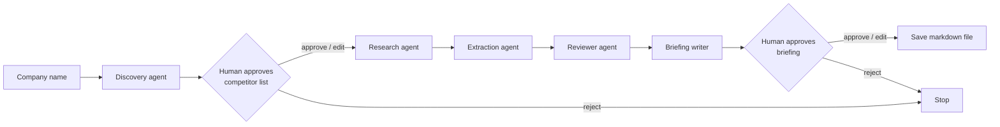

# Competitor Analysis Agent

An AI agent that researches a company's top competitors and produces a **sourced competitor briefing**, with a human approving the competitor list and the final briefing.

> My agent helps a pharma strategy analyst build competitor briefings in a Streamlit app, replacing about 3 hours of manual research per company. It finds 3 competitors, researches each one, and drafts a sourced briefing on its own using 4 tools, hands off to a human to approve the competitor list and the final briefing, and I'll know it works when an analyst gets a usable briefing in under 10 minutes for 3 of 3 test companies.

Built for The Gen Academy certification, Week 3 (Track 2: LangChain + LangGraph).

## How it works



| Step | What it does | Uses |
|---|---|---|
| Discovery | Finds the top 3 competitors from search results only | Tavily + Nebius model |
| Human approval 1 | Analyst approves or edits the competitor list | LangGraph `interrupt` |
| Research | 4 searches per competitor (3 web, 1 news) | Tavily |
| Extraction | Pulls pricing, features, positioning and news, each with a source URL; facts whose URL is not in the search results are dropped in code | Nebius model |
| Reviewer | Checks every fact against its source text; drops unsupported, wrongly categorized or duplicate facts; flags weak sources | Nebius model |
| Briefing | Assembles the Markdown briefing in plain code (no model), so every line carries a source link | Python |
| Human approval 2 | Analyst edits and approves the briefing before anything is saved | LangGraph `interrupt` |
| Save | Writes the approved briefing to `briefings/` | Python |

**State and memory:** one shared `AgentState` (company, competitors, search results, facts, review flags, errors, briefing, approvals) passed between steps by LangGraph. A checkpointer (`MemorySaver`) lets a run pause for approval and resume.

**Error handling:** a failed search or model call is retried once, then recorded as a note in the run issues; the run never crashes and nothing is saved without approval.

## Tech stack

Python 3.12, LangChain + LangGraph, Tavily (search), Nebius Token Factory (Qwen3-235B-A22B-Instruct-2507 via the OpenAI-compatible API), Streamlit, Pydantic.

## Setup

1. Create and activate a virtual environment, then install dependencies:
   ```
   python -m venv .venv
   .venv\Scripts\activate
   pip install -r requirements.txt
   ```
2. Copy `.env.example` to `.env` and fill in your own values (never commit `.env`):
   ```
   TAVILY_API_KEY=
   NEBIUS_API_KEY=
   NEBIUS_MODEL=Qwen/Qwen3-235B-A22B-Instruct-2507
   ```
3. Optional: check that both keys work with `python check_keys.py`.

## Run

- Web app: `streamlit run app.py`
- Console version: `python -m src.graph`

Each agent can also be run alone, for example `python -m src.agents.discovery`.

## Project structure

```
app.py                 Streamlit interface
src/state.py           Shared state and data models
src/tools.py           Tavily search and file-save tools
src/llm.py             Nebius model connection
src/graph.py           LangGraph workflow, approvals, checkpointing
src/agents/            discovery, research, extraction, reviewer, briefing, save
briefings/             Sample outputs from real runs
docs/framework.md      One-liner and agent framework (design)
docs/prompt_log.md     Every prompt sent to Codex and what happened
AGENTS.md              Standing rules given to the AI coding tool
```

## Testing

| Test | Result |
|---|---|
| Wrong Tavily key | No crash; search errors recorded; nothing saved |
| Wrong model name | No crash; model error recorded; nothing saved |
| Human rejects the competitor list | Run stops; no research; nothing saved |
| Human rejects the briefing | Nothing saved |

Success measure: a usable briefing in under 10 minutes for 3 of 3 test companies. Runs for Veeva Systems, Apple and Google each finished in about 1 min 40 s to 3 min, with 11 to 12 of 12 fact slots filled and a source link on every fact.

## Known limitations

- Search-based facts depend on source quality; third-party and blog sources are tagged `(weak source)` but not removed.
- Facts are checked against their own source, not against each other, so conflicting facts can both appear.
- For broad companies, some facts can be about unrelated product lines.
- Competitor discovery varies between runs; the human approval step is the safeguard.
- The reviewer is a model and can occasionally rely on its own knowledge instead of the source text.
- Checkpoints are in memory, so a run cannot be resumed after the app restarts.

## How AI tools were used

The code was written with the Codex extension in VS Code, using the prompts in `docs/prompt_log.md`. Claude was used as a coaching assistant for planning, design decisions and drafting prompts. I ran, tested and reviewed every step.

## Links

- Documentation (Google Doc): _add link_
- Demo video: _add link_